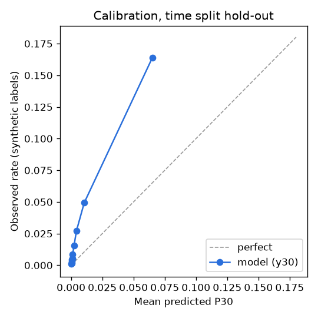

# Risk model evaluation

_Generated 2026-10-17T11:38:14+00:00 by `python -m roadsense.models.risk` (risk-v0.1). as_of 2026-10-12._

**Labels are SYNTHETIC** (Generator 2, seed 2026). Scores on synthetic labels are a pipeline check, not proof the model works on real roads. The real-world check below uses real FixMyStreet reports.

Inputs: segments `mock`, weather `mock`, esal_day `mock`. **Lane A inputs were mocked for this run**, so rerun after Merge 1.

Model: LightGBM, monotone +1 on load, rain, freeze-thaw and rain-then-frost, -1 on recent preventive treatment; scale_pos_weight for imbalance; isotonic calibration on the last 15% of training weeks. Top 5% = mean over weeks of precision among that week's top 5% of segments.

## Time split (last 12 months held out, 30-day gap)

**y7** (test rows 373,728, base rate 0.0069)

| Scorer | PR-AUC | Precision in top 5% | Brier |
|---|---|---|---|
| model | 0.068 | 0.036 | 0.00671 |
| road age only | 0.007 | 0.009 | 0.00689 |
| prior pothole count only | 0.018 | 0.028 | 0.00684 |

**y30** (test rows 373,728, base rate 0.0288)

| Scorer | PR-AUC | Precision in top 5% | Brier |
|---|---|---|---|
| model | 0.228 | 0.142 | 0.02615 |
| road age only | 0.031 | 0.039 | 0.02796 |
| prior pothole count only | 0.073 | 0.114 | 0.02720 |

## Spatial split (wards held out: Mock ward 01, Mock ward 03, Mock ward 13)

**y7** (test rows 76,752, base rate 0.0078)

| Scorer | PR-AUC | Precision in top 5% | Brier |
|---|---|---|---|
| model | 0.067 | 0.040 | 0.00753 |
| road age only | 0.008 | 0.010 | 0.00774 |
| prior pothole count only | 0.020 | 0.031 | 0.00769 |

**y30** (test rows 76,752, base rate 0.0320)

| Scorer | PR-AUC | Precision in top 5% | Brier |
|---|---|---|---|
| model | 0.236 | 0.164 | 0.02860 |
| road age only | 0.032 | 0.041 | 0.03099 |
| prior pothole count only | 0.079 | 0.130 | 0.03011 |

## Leave-one-city-out

Not run: only Southampton is in the table. Port-city features come from lane A; logged in DATA_GAPS.md.

## Calibration (time split, y30)

| Mean predicted | Observed | Rows |
|---|---|---|
| 0.0001 | 0.0013 | 30,519 |
| 0.0005 | 0.0015 | 24,962 |
| 0.0005 | 0.0028 | 54,800 |
| 0.0008 | 0.0045 | 33,376 |
| 0.0009 | 0.0053 | 43,065 |
| 0.0013 | 0.0086 | 34,259 |
| 0.0024 | 0.0156 | 40,216 |
| 0.0043 | 0.0272 | 30,224 |
| 0.0106 | 0.0494 | 44,457 |
| 0.0650 | 0.1638 | 37,850 |

## Real-world check: FixMyStreet Southampton (real data)

Hold-out: real FixMyStreet road-surface reports from 2025-10-12 to 2026-10-12 (`data\fms_dedup.csv`), never used in training. 41 reports, 10 within 15 m of a scored segment. Segments ranked as at 2025-10-06.

| Scorer | Reports in top 10% of segments | Share | Lift vs random (0.10) |
|---|---|---|---|
| model | 0 | 0.000 | 0.000 |
| road age only | 0 | 0.000 | 0.000 |
| prior pothole count only | 0 | 0.000 | 0.000 |

Caveat: segments are mocked, so real report locations do not line up with real streets. This check is only meaningful after lane A's segments land.

Caveat: only 10 hold-out reports, so the lift is very noisy. Southampton FixMyStreet volume is low (no reports 2020 to 2022).

## Wear model (Weibull AFT, lifelines)

Fitted on 1,523 segments resurfaced inside the log window (630 with a first pothole). Shape rho = 0.92. Coefficients (log scale of time-to-first-pothole; negative = wears faster): log_esal_day -0.510, freeze_thaw_rate -0.146, in_flood_area -0.444. Resurfacing history is SYNTHETIC, so wear is too.

## Not done (see DATA_GAPS.md)

- Model trained on synthetic plus real FixMyStreet labels: skipped, too few dated Southampton reports overlap the feature window.
- Leave-one-city-out: waits on lane A's port-city data.
